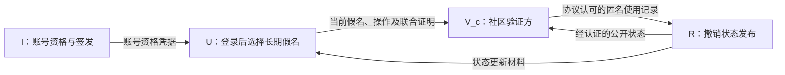
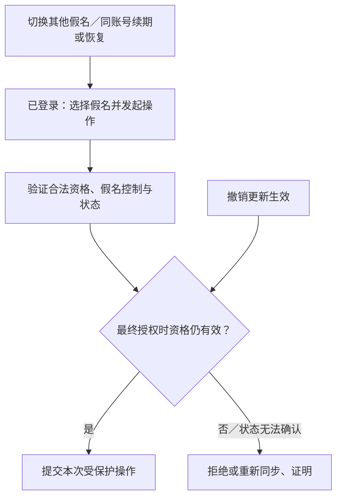

# 多假名匿名社区统一撤销：研究方向与产品改造依据

更新日期：2026-11-17。本文集中保存已经确认的研究方向、立题依据、研究边界、候选基线及产品改造路线，作为开题、后续调研和实现任务的共同入口。交付状态见[本次任务记录](../tasks/THESIS-RESEARCH-DIRECTION-20261116.md)。

研究执行方案版本：**v1.0**。采用状态及绑定版本的独立评估结论以任务记录为准；方案评估通过仅表示可以按阶段开展研究，不代表候选创新、安全证明、性能收益或投稿已经通过。

**已确认：SpeechFUL 后续按论文的隐私目标改造。** 社区验证方应能验证资格、执行统一撤销，而不需要常态掌握同一账号的多个假名之间的关系。本轮交付为研究与改造方案文档；具体密码构造、代码改造及存量数据迁移尚未完成。下文明确区分需求、候选方案和待验证结论。

## 1. 已确定的方向与题目

| 项目 | 当前结论 |
| --- | --- |
| 论文题目 | **《多假名匿名社区的统一撤销与隐私保护机制研究》** |
| 研究方向 | **隐私保护与匿名认证**；具体涉及匿名凭据、隐私保护访问控制和资格撤销 |
| 研究对象 | 同一社区中，由同一账号资格支持的多个长期假名 |
| 核心问题 | 在社区验证方不掌握跨假名对应关系的条件下，使账号资格撤销约束其支持的全部假名的后续受保护操作，并分析历史隐私和完整运行成本 |
| 应用载体 | SpeechFUL 的账号登录、长期假名使用及业务授权流程 |
| 当前阶段 | 研究目标与业务语义已确定；构造选择、安全证明、基线复现和实验结论仍需完成 |

题目保留“匿名”。这里的匿名需要给出观察者与信息边界：同一假名内部保持公开连续性，不同假名之间的共同账号关系应对社区验证方隐藏；这不等于对所有参与方、所有日志和所有网络侧信道都绝对匿名。

研究不要求一定发明新的底层密码算法。现有构件的组合可以形成研究贡献，但须说明新增的安全问题、组合条件或可测量的改进，不能只把多个论文名称拼接后宣称创新。

### 1.1 研究总目标与分目标

**研究总目标：** 面向同一账号资格支持多个长期假名的匿名社区，研究在社区验证方不掌握跨假名关联的条件下，保持统一撤销与当前操作资格验证的正确性，降低资格状态同步和匿名展示的计算、存储及在线等待成本，并通过安全论证和可复现实验确定收益、代价及适用范围。

例如，A、B、C 由同一资格支持。依据 A 的有效记录撤销资格后，B、C 的后续受保护操作均不能成功；社区无须获得 A、B、C 的对应名单。撤销前的历史跨假名隐私须在第 4.3 节的敌手与泄漏条件下分析。能否做到上述性质及所需成本，是要研究和证明的对象，不能以流程描述代替结果。

| 分目标 | 具体研究对象 | 应形成的成果 |
| --- | --- | --- |
| G0：明确安全与运行边界 | 同一隐藏资格、长期假名、撤销状态、最终授权以及续期／恢复的关系 | 安全定义、状态转换规格、基线性质对照；已有能力不重复主张原创 |
| G1：降低资格同步成本 | 连续撤销记录的批量处理，保持完整顺序和不遗漏 | 候选 A 的构造、正确性论证、同步时间／内存与批次大小实验 |
| G2：降低普通更新成本 | 初始化、普通更新、解禁等不同转换及资格继承 | 候选 B 的状态不变式、隐私分析和不同事件比例下的成本实验 |
| G3：降低匿名展示成本 | 已验证资格到当前假名操作的绑定，及展示侧重复检查 | 候选 C 的精简关系、组合论证、在线与累计成本实验 |
| G4：评价完整方案 | 单项改进、兼容组合、多个强基线及应用接口 | 可运行密码原型、配置与结果、局限性；必要的最小应用验证 |

当前以三项机制共同支撑一篇完整论文为研究安排，优先验证 C。只有安全论证和测量支持的机制才进入最终贡献清单；工作量、候选数量和期刊录用分别判断。

### 1.2 可回答的研究问题与检验方式

| 问题 | 待检验假设及可观察预测 | 对照与不支持该假设的结果 |
| --- | --- | --- |
| RQ-A：批量是否能降低完整同步成本？ | 适当批次能摊薄每次证明维护开销；在相同积压量下，时间或时间—内存取舍改善 | 逐条与批量处理相同有效序列；若更大电路、填充和参数成本抵消收益，则不支持该配置，报告交叉区间 |
| RQ-B：分类型是否能降低普通更新成本并保持隐私？ | 普通更新较多时，专用转换的节省超过切换、隐藏控制信息与证明后端成本 | 通用转换与分类型转换；单独设置后端更换对照。若收益仅来自更换依赖，或分支泄漏无法满足模型，则不能归为该机制成立 |
| RQ-C：展示能否安全继承资格，并精简重复证明？ | 保留共同秘密、当前状态、假名和操作绑定后，轻量展示的约束与端到端成本改善 | 完整／精简展示，双方分别启用同样预计算；若资格可拼接、旧状态可用，或仅移动计时边界，则该主张不成立 |
| RQ-ABC：三者是否能安全组合，综合收益是否存在？ | 经兼容性确认的组合在声明负载下优于对应单项或形成更好的成本取舍 | 单项、逐对与全部组合；若收益重叠、额外开销抵消或语义不兼容，应合并贡献或舍弃组合 |

这些是 2026-11-17 的拟检验假设，不是观测结论。后续从结果中产生的新假设另记为探索性，保留原计划和变更理由。

## 2. 已确认的业务语义

### 2.1 登录、账号资格与假名使用

基本流程是“邮箱资格验证 → 获取账号资格凭据 → 检验资格有效性 → 使用长期假名”。用户在登录 APP 后选择或切换假名，假名不被当作另一个独立登录账号。登录是否每次要求邮箱验证属于产品入口细节，不是论文必须采用的前提。

账号资格凭据在本文中也称“根凭据”，二者是同一个对象。它证明持有者具有相应社区资格；当前操作还需要证明对当前假名的控制权，并满足当前撤销状态。APP 显示已登录、切换假名成功，都不能代替最终业务授权。

例如，同一账号持有长期假名 A、B、C。系统依据 A 的一条有效匿名使用记录撤销对应资格后，B、C 的后续受保护操作也应失败。社区无需找到 B、C 的名称，也无需建立一张可查询的共同账号名单。这里的“可验证”是指共同资格约束和操作验证结果可检查，不是向社区枚举全部受影响假名。

### 2.2 哪些关系可以知道，哪些需要隐藏

| 信息或关系 | 已确认目标／边界 |
| --- | --- |
| 邮箱与账号的资格关系 | 注册／签发流程可维护、查询；不要求对所有注册参与方隐藏这层关系 |
| 当前假名及其公开内容 | 社区可见；同一长期假名的内容允许关联 |
| 不同假名是否属于同一账号 | 社区验证方不应通过正常协议、业务字段或可访问日志直接获得这层关系 |
| 某次操作是否由有效资格持有者发起 | 社区需要验证，但不因此获知账号标识或其他假名 |
| 撤销是否作用于同一隐藏资格 | 必须由协议保证；不能预设社区已经知道隐藏账号编号 |
| 撤销后所有假名的未来权限 | 受同一资格约束；不要求服务端逐个定位或展示封禁对象 |
| 同账号续期、再次邮箱验证或凭据恢复 | 应继承原资格的撤销约束，不能因此取得一份脱离原约束的新资格 |
| 不同邮箱重复注册 | 单独依赖注册制度；邮箱控制权不等于自然人唯一性 |

“服务端不知道关联”需要落实到权限和数据流：如果社区仍收到共同账号 ID、同一个 Bearer、Cookie 或可跨请求查询的会话标识，就可能直接关联不同假名。改为两个服务名称或两个进程，不能自动消除这种关联。

## 3. 立题依据

### 3.1 应用中的实际矛盾

长期假名允许用户在不同交流情境中保持各自的历史、声誉和持续互动。与此同时，平台需要把资格约束施加到同一资格支持的全部操作，避免资格已失效后仍利用其他假名继续访问受保护功能。

若社区持有账号到全部假名的映射，按账号检查状态即可实现统一限制；这本身不构成本文要解决的密码学问题。论文增加的约束是：**社区验证方在完成这些检查时，不应获得跨假名的共同账号关系。** 因而立题依据应落在资格约束与验证方隐私之间的兼容性，而不是把“切换假名”误写成现有账号封禁天然失效。

此外，已经登录的 APP 包含身份列表、会话续期、内容归属、本人通知和恢复流程。即使证明系统本身不可关联，外围接口也可能暴露共同账号关系。因此需要把密码协议的隐私目标放到真实应用的数据流中检验。

### 3.2 现有研究已提供的能力

匿名凭据已经研究多次不可关联展示及凭据的一致性；这些是可以借用的基础，而不是本课题新提出的性质。参考 Camenisch 与 Lysyanskaya 的原始工作。[匿名凭据原文](https://cs.brown.edu/people/alysyans/papers/cl01a.pdf)

多假名统一撤销也已有直接先例。Brands、Demuynck 与 De Decker 的工作研究了依据一个假名撤销同一用户其他不可关联假名的系统。因此，本课题不能宣称“首次实现不知道其他假名也能统一撤销”。需要逐项比较其使用范围、信任假设、泄漏与成本。[出版社论文与摘要](https://link.springer.com/chapter/10.1007/978-3-540-73458-1_29)

SNARKBlock 通过隐藏共同输入的聚合证明和分块处理支持匿名阻断，原方案已有证明复用能力。ALPACA 进一步研究可更新证明，其摘要和作者实现说明强调在线证明、验证和证明大小的规模性质。两者说明“共享根资格”“复用已有计算”“增量更新”都不能直接被列为我们的原创贡献。[SNARKBlock 原文](https://www.cs.umd.edu/~imiers/pdf/snarkblock.pdf)、[ALPACA 论文记录](https://eprint.iacr.org/2025/767)

据这些来源，目前更合理的立题位置是：**研究上述机制如何满足已登录、多长期假名 APP 的共同资格约束和信息边界，找出直接组合的真实缺口，再提出并验证必要的改进。** 这是根据应用需求作出的研究判断，尚不是“现有方案均无法做到”的结论。

### 3.3 仍需回答的研究问题

1. 合法凭据、当前假名控制权与未撤销证明，如何绑定同一隐藏资格，避免从不同持有者处拼接证明？
2. 如何依据协议认可的匿名使用记录形成撤销约束，使同一隐藏资格的其他假名也失效，同时不引入可公开关联的稳定标识？
3. 账号登录、假名展示和最终业务授权分别暴露什么？协议的不可关联性在应用会话和日志中是否仍成立？
4. 撤销生效、并发提交、离线返回和凭据恢复，如何保持一致的资格约束？相应成本是多少？
5. 在保留基线全部既有优化的条件下，多长期假名适配新增了哪些开销，其中是否存在新的安全复用或状态维护优化？

前两个问题不预设已有方案缺失相应能力；如果基线已经覆盖，应记录复用方式并缩小创新主张。研究问题的价值来自明确的模型、反例、论证与测量。

### 3.4 工作量与成果边界

该方向能够形成“模型与安全目标 → 直接组合与失效分析 → 改进机制 → 原型与实验”的完整研究链条。范围集中在账号资格与多个长期假名的关系，已有足够的协议和系统交叉问题；没有必要为了扩大题目加入身份追踪、通知系统或内容识别算法。

硕士论文的工作量与期刊论文的新颖性是两个判断。原型集成可以贡献工作量，但期刊主张仍需要相对于既有研究的明确增量。如果复核发现现有方案已完整满足目标且没有新的分析或实测贡献，应调整贡献表述或研究切口，不能用工程代码量代替新颖性。

### 3.5 能否形成论文与期刊投稿成果

当前判断是：**该方向值得继续开展硕士论文研究，但期刊所需的学术增量尚未得到证实。** 题目范围集中不是主要风险；主要风险是将既有方案已经实现的能力误写成新贡献。课题获准、开题通过、达到学位论文要求和期刊录用也不是同一项验收。

面向期刊，按 2026-11-17 的进一步讨论，保留批量同步、分类型转换、轻量展示三项拟研究机制，取消“前两项主要、第三项备选”的固定划分。当前优先检验第 8.4 节：从资格结论的安全继承、在线约束精简和一次性预计算入手。三项可以共同组织论文，但独立贡献数由最终安全论证与实验决定。共同资格约束、状态新鲜性和跨假名隐私仍是安全边界。当前有作者代码与原始资料支持切口，尚无本项目的密码学性能实测，也未证实期刊所需的新颖性。

| 可形成的成果路径 | 至少应交付的实质内容 | 不能替代该内容的工作 |
| --- | --- | --- |
| 组合与安全分析 | 明确的新增应用条件、非人为制造的失效反例、修正机制及相应论证 | 给已有性质换名、只画架构图、删掉基线检查后制造漏洞 |
| 机制与性能改进 | 保持相同安全目标的新机制；相对公平直接组合的可复现收益及代价 | 移到后台后不计成本、使用更弱参数、重复维护本可共享的状态 |
| 系统与实验研究 | 可推广的问题和设计结论；完整的信息流分析、实现与多条件实验 | 只展示 APP 功能、只复述作者图表、单一环境的一次跑分 |

不必三条全部完成，但应形成至少一条完整、证据充分的主线，并用其他部分支撑它。选定切口后再把期刊论文题目收窄到实际贡献；当前开题题目可以作为整体研究范围保留。

继续投入的判断节点应放在大规模产品改造之前：完成核心构造复核和最小直接组合，交付性质对照、初步测量以及一个候选贡献说明。若已找到未被覆盖的问题且修正有理论或实测价值，继续深化；若现有方案已经直接满足目标、没有新的分析结论或收益，就调整研究切口。不能以“APP 还需大量改代码”作为继续宣称论文创新的依据。

当前尚未确定目标期刊及学校认可要求，因此不承诺录用或具体期刊层级。后续选刊应根据实际成果、论文类型和导师要求匹配，而不反过来用未经验证的性能承诺包装成果。

## 4. 研究范围与隐私承诺

### 4.1 纳入范围

- 同一社区、同一账号资格下的多个长期假名。
- 凭据有效性、当前假名控制权与当前未撤销状态的联合验证。
- 基于有效匿名使用记录的资格撤销，以及对后续受保护操作的一致约束。
- 撤销前历史记录的跨假名隐私，及撤销发生后观察既有记录时的关联风险。
- 状态更新、缓存、离线积压、并发授权及账号凭据续期／恢复的条件。
- 原型、直接组合基线、改进方案及完整成本实验。

### 4.2 不纳入本轮论文核心

真实身份揭示、门限追踪实现、邮件通知、历史内容删除、内容审核分类算法及网络匿名通信，不作为本课题的研究模块。身份开启和多机构追踪仅可用于相关工作及隐私风险讨论，不构成当前方案的接口或创新点。

产品可能需要禁言、限时限制和恢复资格。首轮密码原型建议先验证最小的资格撤销语义；期限、作用范围、解除限制和旧证明是否恢复有效需要另外定义，不能假设任意黑名单方案天然支持这些行为。这是分阶段实施建议，不表示取消产品需求。

### 4.3 敌手与允许泄漏

隐私分析以社区验证方能够观察的协议消息、业务字段和实际可访问日志为基础。至少区分被动记录、主动重放／探测，以及签发方与社区方串通的情形；不能把“不串通”默认为已经实现的组织或技术事实。

可以显式建模的公开信息包括当前假名、同一假名的公开历史、公开撤销状态及认证结果。认证成功或失败本身可能提供关联线索，特别是在定向列表、少量用户或主动探测情境中。必须说明隐私实验的约束与泄漏，而不能只凭使用零知识证明就声称完整历史不可关联。

共同账号标识、跨假名会话 Cookie 或可查询的身份映射，直接违背所讨论的目标，不能通过把它们列入“允许泄漏”来使结论形式上成立。IP、时序、写作风格及设备侧信道不在基础密码协议的保证范围内，应用评估仍应记录其存在。已泄漏给服务端的历史映射，也不能仅靠部署新协议就被证明遗忘。

## 5. 简要系统模型

### 5.1 角色与数据

论文使用四个逻辑角色。为避免与仓库现有校邮验证服务 V 混淆，本文将**社区验证方**写作 `V_c`；该符号不表示当前 V 服务。

| 角色／对象 | 含义 |
| --- | --- |
| `U` | 用户客户端，持有凭据、秘密和假名控制材料，登录后选择当前假名 |
| `I` | 账号资格与签发角色，负责注册资格和凭据签发；具体部署及查询权限待设计 |
| `R` | 撤销状态发布角色，处理有效撤销输入并发布经认证的状态 |
| `V_c` | 社区验证方，验证当前假名的受保护操作 |
| `a`、`q_a`、`C_a` | 账号、稳定的隐藏资格、绑定该资格的账号资格凭据 |
| `x` | 持有者秘密；不能把掌握这个秘密解释成自然人唯一性证明 |
| `S`、`p`、`m`、`n` | 社区、当前长期假名、当前操作、单次挑战 |
| `Σ_v` | 版本为 `v` 的经认证撤销状态 |
| `w_p`、`w_v` | 假名控制与当前资格状态的私有见证 |

`q_a` 是分析中的稳定资格对象，不要求作为社区可见的数据库键。注册服务可查询邮箱与账号，也不意味着必须知道客户端秘密 `x`；秘密生成、签发可见性和串通假设须由具体构造明确。



图中的角色划分表达待实现的信息边界，不是“拆成几个服务就已经匿名”的证明。`I`、`R`、`V_c` 的实际部署、权限和串通能力必须另行核对。

### 5.2 共同见证关系

公开上下文 `Γ` 至少包含 `S、p、m、n、v`；私有见证 `W` 包含 `q_a、x、C_a、w_p、w_v`。以签发公钥 `pk_I` 表示合法签发验证所需参数，目标关系为：

```text
R(Γ, Σ_v; W)
  = CredOK(pk_I, C_a; q_a, x)
  ∧ NymOK(S, p; q_a, x, w_p)
  ∧ Eligible(q_a, Σ_v; w_v)
```

三个谓词分别表达合法资格、当前假名控制权和未撤销资格，并须约束同一 `q_a` 与 `x`。证明或其认证上下文还必须绑定本次操作、社区、挑战和状态版本，避免用于另一操作或重放。仅把这些字段写进符号列表，并不等于实现了绑定。

第 8.4 节 C1 的 `k` 对应持有者秘密 `x`，不与稳定资格 `q_a` 自动等同。资格继承还须约束凭据、初始状态与冷启动锚点：即使重签时保留同一个秘密，也不能通过将启动位置移到既有撤销之后而绕过限制。秘密轮换、重签和恢复是否允许，以及如何保持这些关系，属于 P0 必须冻结的生命周期定义；该符号说明不是已经完成的生命周期构造。

该关系是安全规格，尚未指定电路、签名、承诺、假名派生函数或证明系统。不能由这条公式直接推出安全性或效率；需要核查候选构件的公开输入、秘密分布、编码方式和证明假设是否兼容。

### 5.3 匿名记录到撤销约束

撤销输入记为有效匿名使用记录 `d`。需要给出一个可核验的更新流程，使状态变化约束产生 `d` 的同一隐藏资格。不可把这一关键接口简化为“读取账号 ID 后封禁”，再声称社区不知道账号归属。

协议还应防止伪造记录或替换绑定材料导致无关资格失效。撤销判定所依据的社区规则与处理程序属于产品治理，密码协议只证明输入有效、约束对应正确及后续检查一致，不自动证明处理决定本身正确。

### 5.4 生效语义与基本性质

建议以最终业务授权／提交点作为撤销生效检查边界，使撤销更新和业务提交有可解释的一致先后关系。撤销已经生效后，旧登录状态、缓存证明和假名切换均不能免除当前资格检查；状态新鲜性不确定时，需要明确等待、重新证明或拒绝的路径。



需要论证或验证的性质包括：有效资格正常可用、资格不可伪造、假名控制权一致、统一撤销可靠、无关资格继续可用、抗重放，以及给定泄漏模型下的跨假名隐私。全部拒绝虽然能阻止已撤销资格，也不满足正确性和可用性。

严格的新鲜状态要求可能使正在生成的证明过期。具体状态版本策略尚待比较，实验必须计入重试、失败率和可用性，不能只报告一次证明的密码运算耗时。

## 6. 候选基线与文献核实状态

下表为当前已定位的关键来源，核实日期为 2026-11-16 至 17 日。它不是完整系统综述，也不表示已经精读或复现了 200 篇论文。

| 工作 | 可借鉴或比较的部分 | 已核实证据 | 尚未完成 |
| --- | --- | --- | --- |
| Camenisch–Lysyanskaya 匿名凭据，2001 | 凭据持有证明、多次展示及一致性；用于模型和构件背景 | 原文摘要及引言 | 与候选阻断实现的具体接口兼容性；不默认整套嵌入 |
| Brands–Demuynck–De Decker 全局假名撤销，2007 | 直接比较“多个不可关联假名统一撤销”的既有能力与安全边界 | 出版社摘要及正式论文元数据 | 全文逐项安全比较、适配和性能复现 |
| **SNARKBlock，IEEE S&P 2022** | 隐藏共同输入聚合、分块复用；证明、验证、同步成本 | 原文相关章节、实验章节、作者代码 README | 本机编译运行、完整证明审读、固定版本复现 |
| **ALPACA，IEEE S&P 2025** | **主要候选基线**；可更新匿名阻断证明和完整维护成本 | ePrint 摘要及出版信息、作者 74 页讲稿、同步／授权／解禁代码、ZoKrates 关系及 Nova 0.37.0 接口 | 论文完整证明逐项复核、公开实现与讲稿对齐、编译、实验复现及适配开销 |
| **zk-BAN，2026 预印本** | 签名式撤销、离线返回和计算成本的近期对照候选 | ePrint 摘要及预印本元数据 | 全文、代码归属、可运行性、原始数据和可比功能；尚未确认为实测基线 |

代码与实验材料必须分开记录：

| 方案 | 公开实现入口 | 当前可确认的运行入口 | 原始实验数据状态 |
| --- | --- | --- | --- |
| ALPACA | [alpaca](https://github.com/jiwonkimpark/alpaca)、其 README 指向的 [circ-alpaca](https://github.com/jiwonkimpark/circ-alpaca) | README 提供构建说明与 `cargo run --release --example example` 示例 | 未完成机器可读原始结果及完整绘图材料的核验；公开代码不等于原始结果齐全 |
| SNARKBlock | [snarkblock](https://github.com/rozbb/snarkblock)、[hiciap](https://github.com/rozbb/hiciap) | README 指向 `run_benches.sh` 及 Criterion 输出 | 论文有实验图表；尚未确认作者全部原始运行记录可直接下载 |
| zk-BAN | 尚未核实作者代码入口 | 尚未核实 | 摘要报告性能结果，不能当作已取得实验数据集 |

以上入口只表明公开材料存在，不表示代码已经适配当前环境、经过本项目安全审计或可以直接上线。复现前固定依赖、提交版本和参数。BLAC、PEREA、动态累加器、范围可撤销假名及其他近期匿名阻断工作仍需继续做性质比较；不能因当前表较短就推断只有一篇可比较论文。

国内相关匿名凭据和身份认证研究应继续补充原始来源，按实际机制与安全定义比较；当前证据不足以对“国内研究整体缺少何种能力”作概括性判断。

## 7. 直接组合基线怎么建立

### 7.1 最小组合的组成

优先考察 ALPACA 原有签发／身份绑定及匿名阻断机制，在其允许的接口上接入长期假名控制证明，再接入受保护操作上下文和状态版本检查。SNARKBlock 按相同目标建立对照。具体假名绑定方式在核对构造后选择，不预先指定某个派生公式就宣称组合完成。

| 部分 | 可以直接借用的方向 | 必须核查或补齐的内容 |
| --- | --- | --- |
| 资格与持有者绑定 | 候选方案已有的身份／签发接口 | 与邮箱注册资格的衔接；重签发是否保留撤销约束；签发方能观察什么 |
| 匿名阻断 | ALPACA 或 SNARKBlock 的原有机制 | 撤销输入记录是否充分绑定资格；原有安全定义是否覆盖目标用法 |
| 长期假名 | 现有凭据及假名控制技术 | 同一资格支持多个长期假名的证明关系、公开标识及可关联信息 |
| 状态维护 | 基线原有更新、分块、缓存与随机化 | 应用适配新增材料是否可复用；版本过期和离线返回如何处理 |
| 业务授权 | SpeechFUL 最终业务检查的职责 | 如何用隐私保护的资格和归属证明实现职责，避免继续向社区提供账号关联 |

不能假设把几个独立证明并排提交就满足共同见证，也不能用固定公开根承诺来绑定全部展示而忽略它本身可能成为关联标识。

### 7.2 三组比较

1. **作者原方案**：按论文自己的功能与参数运行，确认实现和计时边界；用于复现与参考。
2. **满足本文语义的直接组合**：保留作者已有能力，补齐长期假名、上下文和状态接口；作为新增改进的主要比较对象。
3. **直接组合加本课题改进**：仅改变待论证的新部分，保持相同功能、安全参数、硬件和负载。

作者的缓冲、分块大小或更新方式等实验变体，是同一方案的配置，不应自动当作多篇独立 baseline。不同论文功能不一致时可以做性质、复杂度或局部开销比较，不强行输出一个总速度排名。

尤其不能人为让 ALPACA 为每个假名完整重复维护一套本可共享的持有者状态，然后把消除这种重复当作创新。消融实验应开关本课题新增机制，同时保留必要安全检查和基线原生优化。

## 8. 研究内容与可能贡献

**性能改进可以独立形成贡献，不要求增加前人从未支持的功能。** 已有方案支持删除、批处理或匿名证明，并不排除我们在这些功能上做得更快、更省内存，或者在某类负载下取得更好的综合成本。需要提出并解释改进机制，在对齐安全目标和条件的比较中报告收益与代价；不能仅凭“有某功能”或某一次跑分认定创新成立。

性能贡献不必降低渐近复杂度，也不必在所有指标和场景上同时领先。针对离线积压、内存受限客户端或频繁更新取得可复现且有意义的改善，也可以形成研究结果。没有一个通用的“提速多少就算创新”的百分比门槛；应说明适用条件、原因、已有工作的覆盖范围，以及收益是否来自所提出的方法。

| 研究内容 | 可能形成的贡献 | 需要成立的证据 |
| --- | --- | --- |
| 已登录、多长期假名应用的隐私模型 | 明确账号登录、假名使用、认证结果及日志之间的关联边界 | 相对既有定义的真实差异、可解释反例和形式化安全目标 |
| 共同见证与撤销接口适配 | 给出组合条件、失败情形和满足目标的构造／适配 | 防拼接、防误撤销、正确性及撤销可靠性的论证；不能仅靠流程图 |
| 撤销状态与最终业务授权 | 明确并发、缓存、旧证明和离线返回的生效语义 | 可复核事件序列、反例修正，以及一致的授权验收 |
| 资格更新与展示的计算优化 | 批量状态转换、分类型增量验证或展示包装改进，降低维护或在线成本 | 保留基线原生优化；同条件实测、组合安全论证及适用区间；无收益时如实报告 |

目前这些是待验证的贡献候选，不能在开题或论文中写成已经完成的算法创新、已证明性质或已达到的性能指标。门限追踪、通知、普通身份切换界面不作为“补足创新点”的附加模块。

### 8.1 从原文与实现定位瓶颈

| 来源与核实位置 | 已观察到的机制／限制 | 可以研究的性能问题 |
| --- | --- | --- |
| ALPACA 作者 `src/blocklist.rs`：`synchronize`、`updatable_synchronize` | 对尚未同步的记录逐条调用更新，每次推进 IVC；已有状态可以续算 | 每条记录都承担的证明维护开销能否按批次摊薄；不减少应检查的记录 |
| 同文件 `f`、`rerandomize_usync_proof`；`f_circuit.rs` 与 `r1cs_adapter.rs` | 处理凭据、普通记录、解禁及重随机化等逻辑；当前电路入口加载同一份 `IVC_R1CS` | 普通更新是否承担过多通用电路成本；分离电路后节省是否大于切换与隐藏分支的代价 |
| 同文件 `authorize_token`，及 `relation_nova/zksnark.rs` | 授权会调用重随机化、IVC 压缩证明及发帖关系证明 | 各阶段中是否有可合并、复用或替换的开销；不能直接删除匿名性与共同见证所需步骤 |
| SNARKBlock 原文第 7、8.2、8.3 节 | 已有分块与缓冲，仍需同步工作；冷启动需要准备既有列表对应材料 | 离线积压、批次大小、内存与在线延迟之间的取舍；已有分块本身不作为我们的新机制 |
| zk-BAN ePrint 摘要 | 通过列表筛选和部分统一 PRF 标签减少重复计算 | 说明“减少必要计算之外的冗余”是相关路线；全文当前未取得，不引用二手材料中的内存或延迟数值作为已核实局限 |

ALPACA 代码核对日期为 2026-11-17，`src/blocklist.rs` 的 Git blob 为 `240a2bca9bf017d08d725331dd51a092386a27bc`，`f_circuit.rs` 为 `5daa67623b66ded254dcc80dd6c67701738961c7`。blob 用于标识已读文件内容，不是本项目提交。公开入口：[同步与授权代码](https://github.com/jiwonkimpark/alpaca/blob/main/src/blocklist.rs)、[电路入口](https://github.com/jiwonkimpark/alpaca/blob/main/src/proofs/relation_nova/ivc/f_circuit.rs)、[压缩证明](https://github.com/jiwonkimpark/alpaca/blob/main/src/proofs/relation_nova/zksnark.rs)。上述阅读没有测出各环节耗时占比，后续必须先做分项测量。

### 8.2 候选 A：保持撤销完整性的批量资格同步机制

**拟改动：** 保留 ALPACA 的连续状态与匿名展示语义，将连续 `b` 条记录的检查放入一个批量状态转换。每条记录仍做资格相关检查，批次内部验证完整顺序，折叠／递归状态的维护以批次为单位完成。SNARKBlock 的分块思想可作为组织方式参考，HyperNova 的多实例折叠可作为进一步技术候选；两者都不是直接套用后就自动满足 ALPACA 的匿名增量证明定义。

以 `d` 表示待处理记录数、`F` 表示每步固定维护成本、`C` 表示每条检查成本，第一轮可用如下假设指导测量：

```text
逐条处理：T ≈ d × (F + C)
批量处理：T ≈ ceil(d / b) × F_b + d × C_b + T_binding + T_padding
```

`F_b` 和 `C_b` 必须实测，不能假设批量后与原值相同。目标是降低常数开销，不预先承诺把完整同步从线性复杂度变成常数。批次变大也可能增加内存、等待时间和电路参数成本。

**必须保留：** 起止状态绑定、记录连续性、真实批次长度、尾批填充约束、同一隐藏资格，以及全部被处理记录的有效性；不能跳过导致本资格撤销的记录。私有同步材料可复用，跨假名公开展示仍要满足随机化和不可关联要求。

**首轮实验：** 原始逐条更新、固定批次 `b=2/4/8/16`、内存受限的批次选择；比较每条记录耗时、离线追赶总耗时、峰值内存、在线等待及尾批成本。先固定批次验证收益，再决定是否研究自适应选择。按当前安排，在 C 的最小实验与共同资格不变式核查之后开展该项预实验。

### 8.3 候选 B：隐私保持的分类型资格状态转换机制

**拟组合：** ALPACA 的资格状态转换，结合 SuperNova／HyperNova 的非统一增量计算思想，将初始化、普通更新、解禁处理和展示准备定义为不同类型的转换。每种转换仍证明完整的安全条件，普通更新尽量只承担实际需要的约束。[SuperNova 原始说明](https://eprint.iacr.org/2022/1758)、[HyperNova 当前版本](https://eprint.iacr.org/2023/573)

这不是把 Rust 中的 `if` 拆成几个函数。要核对编译出的约束和状态机，证明凭据在初始化验证后，后续每一步始终继承同一合法资格；否则移除重复签名检查会变成安全缺口。分支类型、调用次数或选择器如果对外可见，还可能泄漏是否曾被限制、何时恢复等信息，因此必须分析隐藏分支所需的成本。

**可能的贡献：** 面向匿名撤销的状态转换划分、绑定不变式和隐私保持方法，以及普通更新占多数时的性能改善。即使证明后端已经存在，针对该协议的安全适配和经实测成立的成本改善仍可作为贡献候选；单纯升级依赖则不足以说明这一贡献。

**首轮实验：** 对齐安全参数，分别测量原电路与分离电路的约束数、证明时间、参数／状态大小；改变普通更新与特殊处理的比例。用 A、B 分别启用和同时启用的消融比较，区分批量收益与电路划分收益。建议将 A、B 视为一条“低开销资格维护”主线的两个候选机制，不预先凑成两项独立原创结论。

### 8.4 候选 C 专项核查：基于资格继承的轻量匿名展示机制

**当前判断：提升为优先验证的主攻候选，暂不宣称已形成主要创新成果。** 最有代码依据的起点是“让展示证明安全地继承已证明的资格，精简重复约束”，再研究一次性预计算和最终展示步骤的合并。不能把“使用 NovaBlindFold”本身当作已经成立的改进。

#### 8.4.1 已核实的授权路径及各环节职责

本次补读了作者主页直接链接的 [ALPACA 讲稿](https://drive.google.com/file/d/1SrtIHLx8ya5li8jAe0bEOMqR8d6dQFfI/view)，共 74 页。第 51—54 页说明冷启动会使实际迭代次数暴露加入时间，因而需要 iteration-hiding IVC；第 61—66 页说明两类授权证明及每次展示时重新随机化承诺的原因。第 68 页报告同步与授权电路规模分别为 31,842 和 16,287；这是作者报告，尚未由本项目编译复现，也不能据此直接推算时间占比。

| 环节 | 已观察到的实现 | 对第三点的意义 |
| --- | --- | --- |
| 生成当前操作 token | `extract_token` 计算消息摘要、随机 nonce 及 PRF 标签 | 消息、假名和挑战的最终绑定要保留；消息尚未确定时不能预先完成整个操作证明 |
| 更新展示承诺 | `rerandomize_usync_proof` 从保存的同步状态追加一次只更新承诺的 IVC 步骤 | 同一状态重复展示需要避免公开相同承诺；直接删除会产生等值关联 |
| 压缩／封装同步证明 | `ZkSnarkIVC::prove` 调用 Nova 的 `CompressedSNARK::prove` | 可研究后端替换或预计算，但要同时考察证明大小、验证成本、隐藏状态与隐藏步数 |
| 证明 token 合法 | `relation_post.zok` 同时检查 PRF 标签、当前承诺开启、签发签名及原注册承诺开启 | 与同步关系中的凭据检查存在可定位的重复，值得分析是否能删除展示侧重复部分 |
| 最终验证 | 当前状态、token 与两类证明的验证必须共同成立 | 返回“某个 IVC 证明有效”不足以代表它与本次展示使用相同终态和秘密 |

源码依据：[授权流程](https://github.com/jiwonkimpark/alpaca/blob/main/src/blocklist.rs)、[展示关系](https://github.com/jiwonkimpark/circ-alpaca/blob/master/alpaca/relations/relation_post.zok)、[同步关系](https://github.com/jiwonkimpark/circ-alpaca/blob/master/alpaca/relations/function_f.zok)。后两者核对 blob 分别为 `1c02d1338a69ffa3e59f9da626065fe02715117e`、`c84e32033861c348243ac5a7926f45da5a4c3002`。

#### 8.4.2 C1：资格结论继承与展示约束精简——首先验证

**具体改动候选：** 在同步证明已经保证签发资格合法、当前未撤销以及秘密与终态承诺一致的前提下，展示证明仅证明“当前 token 和假名由同一个秘密产生”。拟移除展示关系中的重复签发签名验证，以及仅服务于该签名验证的原注册承诺开启；保留当前展示承诺开启、PRF、假名控制和操作绑定。

这是有条件的逻辑推导，不能直接在作者代码里删检查就宣布安全。设 `k` 对应本文持有者秘密，`c` 为新鲜展示承诺，`ctx` 包含社区、当前假名、操作、挑战及版本。目标分解为：

```text
R_sync(Σ_v, c; k, credential, r, w)
  = ValidCredential(credential, k)
    ∧ NotRevoked(k, Σ_v; w)
    ∧ Open(c; k, r)

R_show(ctx, token, c; k, r, w_p)
  = Open(c; k, r)
    ∧ TokenOK(token, ctx; k)
    ∧ NymOK(ctx.p; k, w_p)
```

若两类证明具备适当的知识可靠性／可组合提取性质，且承诺具有绑定性，则两个成功证明中的 `k` 应一致，展示可以继承同步关系里的资格结论。还需证明从初始化到终态的关系始终成立，包括冷启动、解禁、重随机化和恢复路径。凭据到期、签发方密钥／策略版本变化等当前有效性检查，不能以“以前验证过签名”为理由取消。

**目前得到的可行性结论：** 在上述规格层面，重复签名检查存在精简空间；源码已定位到具体关系。尚未完成 ALPACA 安全归约适配或编译后约束验证，因此这是可实现性较明确的原型候选，不是已经证明的新协议。

**可能节省什么：** 展示侧的一次签发签名验证及相关承诺运算。作者签名电路中包含两次标量乘法，这解释了值得测量的原因，但编译器优化、约束布局及 IVC 压缩成本都会影响总收益。[签名电路](https://github.com/jiwonkimpark/circ-alpaca/blob/master/alpaca/signature/schnorr.zok)

新颖性上，SNARKBlock 已将签发证明、未撤销证明与标签证明分开并通过隐藏共同输入关联。因此不能宣称“首次让签发证明复用”；要研究的是对 ALPACA 增量状态和多假名展示的具体安全适配、减少了哪些实际成本，以及能否优于充分优化的基线。[SNARKBlock 第 5 节、图 2—3](https://www.cs.umd.edu/~imiers/pdf/snarkblock.pdf)

#### 8.4.3 C2：一次性预计算与当前操作后绑定——配套优化

作者实现的重随机化和 IVC 压缩调用不接收当前 token；这一部分可以研究在消息尚未确定时准备。客户端为同一已验证状态生成若干相互独立的一次性展示材料，每份具有新鲜承诺和相应证明；发起操作时再生成 token 及轻量展示证明。

必要条件是：材料仅用于匹配的当前撤销状态与签发策略版本；公开展示材料每次使用必须避免跨假名复用；保留挑战与操作绑定，处理崩溃、重试和多设备重复使用。新撤销状态生效后，旧版本预计算材料不能延长使用资格；没有有效材料时要同步／重新生成或拒绝。不能把私有计算材料的复用误写成公开相同证明可无限复用。

它可以降低准备充分时的在线等待，但不自动减少总计算量。需要记录未使用材料被状态更新作废的成本、内存、命中率和失败重试。SNARKBlock 已有离线同步和预计算，MLS 的 COSMOS／COSMAC 工作也采用离线／在线分离；这些是已有方法。我们的比较须包含“基线也采用相同预计算”的一组，才能区分 C1 的真实收益与单纯移动计时边界的效果。[SNARKBlock](https://www.cs.umd.edu/~imiers/pdf/snarkblock.pdf)、[MLS 认证原文，第 3—4 节](https://www.usenix.org/system/files/usenixsecurity25-hashimoto-blocklistable.pdf)

COSMAC 的参与方、组内共享秘密和认证保证与公开社区不同，本课题只借鉴成本分解与一次性材料思路，不直接移植它的认证或追踪模块。

#### 8.4.4 C3：最终展示步骤合并——更高难度扩展

另一条路线是将“新鲜承诺／匿名展示准备、当前 token、当前假名绑定”放入一次最终状态转换，使最终证明一并证明这些条件，研究是否可省去单独的 `post_proof`。SuperNova／HyperNova 的不同类型转换可用于避免让每次普通同步都承担完整展示电路的成本。

难点在于：合并后的状态机仍需满足 iteration-hiding；不得公开可复用的私有状态或引入可关联的控制信息；每次展示应从私有同步状态派生独立分支，不能把上次假名公开信息带入下次展示。还需要比较新增转换、递归验证、证明尺寸和后端替换的代价。

该路线比 C1 改动更深，具有进一步的组合研究空间，但目前没有兼容性证明或可运行构造。应在 C1 与基线得到分项数据后，决定是否将其作为主要机制，而不因为“从两个证明变成一个”就预设更快。

#### 8.4.5 NovaBlindFold、Sonobe 与 MicroNova 能提供什么

本次通过作者公开副本读到 HyperNova 第 7 节关于盲化与简洁性分离的构造说明。取得的副本为 90 页，SHA-256 为 `4c3319b2cf751fd49dea527a7a719099d1d21656b77e3258e5c0fa1f9ffbd9fb`；保留来源与指纹，不保存 PDF。该副本的附录结构与当前 ePrint 修订说明应分别记录。[作者公开副本](https://www.andrew.cmu.edu/user/bparno/papers/hypernova.pdf)

| 方法 | 可以借用的能力 | 不能直接推出的结论 |
| --- | --- | --- |
| HyperNova／NovaBlindFold | 通过盲化折叠实现零知识，再按需要单独提供简洁性层 | 不能因此直接删掉应用承诺重随机化、迭代次数隐藏或共同资格绑定 |
| Sonobe 的 `RandomizedIVCProof` | 已有可读实现，可作为零知识 IVC 的实验构件 | 官方文档明确：其无压缩形式更大、验证更贵；不能直接当作低成本短证明 |
| 最终压缩外包 | Sonobe 文档讨论先盲化、后由服务端压缩的用途 | 文档所述该用途需要修改 Decider；外包服务看到的信息、链接性、通信与总成本必须另算，不能声称现成无缝接入 |
| MicroNova／MicroSpartan | 可作为改进最终压缩和验证成本的对照后端 | 基于配对／KZG 的路线引入通用可信设置及曲线迁移成本，不能把信任假设变化忽略后直接比较 |

一个可直接观察的反例是：所读 Sonobe 版本的 `RandomizedIVCProof::new` 把原来的 `U_i`、`u_i` 复制进展示对象。如果对同一保存状态重复调用该函数，再直接公开这些字段，新增随机量并不会消除旧字段相等形成的关联。因此“零知识化原始 IVC”不自动替代 ALPACA 的匿名展示层。这是针对该直接组合的接口分析，不是对 Sonobe 自身声明用途的漏洞结论。

来源：[Sonobe 官方说明](https://sonobe.pse.dev/usage/nova-zk.html)、[文档所链接的固定版本实现](https://github.com/ethereum/sonobe/blob/7097c001fc876578be2229d3590d506858bc0069/folding-schemes/src/folding/nova/zk.rs)、[MicroNova 原始记录](https://eprint.iacr.org/2024/2099)。当前 [Microsoft Nova README](https://github.com/microsoft/Nova) 也说明压缩前已有随机实例折叠，故“换用已有盲化后端”应列作对照或构件，不能直接声称发明该技术。

HyperNova 的 2026-02-20 版本说明是把已有附录结果移至第 7 节并命名 NovaBlindFold，不能误写为其全部技术在 2026 年才首次出现。[版本说明](https://eprint.iacr.org/2023/573)

#### 8.4.6 基线对齐问题及本次验证边界

本次核对 `Cargo.lock` 确认作者示例使用 `nova-snark 0.37.0`，从公开 crate 的 `.cargo_vcs_info.json` 定位到 Nova 提交 `d2c52bd73e6a91c20f23ae4971f24ad70a9d0395`。当前作者示例与论文所述性质仍需对齐，不能直接把示例视为已经验收的安全基线：

- **步数隐藏**：作者讲稿明确要求 iteration-hiding；公开示例的 `AuthProof` 包含 `steps_count`，并直接把它送入标准 Nova 验证接口，需要核对其与论文构造的差异。
- **终态绑定**：Nova 0.37.0 的压缩证明验证返回终态，而 ALPACA 包装接口只保留 `is_ok()`；实验前应检查终态与外层撤销摘要、展示承诺和公钥上下文的一致性。[固定版本 Nova 接口](https://github.com/microsoft/Nova/blob/d2c52bd73e6a91c20f23ae4971f24ad70a9d0395/src/lib.rs)、[ALPACA 包装接口](https://github.com/jiwonkimpark/alpaca/blob/main/src/proofs/relation_nova/zksnark.rs)
- **关系约束与运行分支**：展示关系将多项检查差值相加后返回；差值之和为零一般不等于各项都为零，需要检查编译后的实际约束。IVC 适配层还需核对输入／输出变量的约束绑定；重随机化传入空区块时的分支也需要执行验证。

这些是源码与接口层面的待复现问题，不将其写成对论文安全证明的否定，也不把修复示例本身当作本课题的性能创新。基线和改进版本必须具有相同的正确检查，再比较成本。

本次完成的是原始资料阅读、源码路径检查、候选关系分解和直接组合反例分析。Windows 与现有 WSL 的可见环境中未发现可直接使用的 Rust、zsh、cvc 或 cbc 命令，未安装工具链，未编译作者电路。**真实约束数、密码原型、运行时间和完整安全证明均未完成。** 不把源码分析称为密码学实测通过。

#### 8.4.7 是否作为主要创新及最小判定实验

建议主攻候选命名为：**面向统一撤销的轻量匿名资格展示机制**。核心先验证 C1，再评估 C2 对实际在线等待的改善；C3 保留为更深的机制扩展。课题总题目暂不因这一优先顺序调整而改变。

| 判定项 | 最小实验／论证 | 决策意义 |
| --- | --- | --- |
| C1 是否成立 | 完整同步关系与精简展示关系的共同秘密证明；覆盖冷启动、恢复、旧状态和不同资格拼接 | 不能安全继承时，不移除重复检查 |
| C1 是否值得做 | 同一后端下分别测重随机化、压缩、完整／精简展示的约束数、时间、内存和证明大小 | 只改善极小环节时，不夸大总收益；考虑 C3 或其他切口 |
| C2 是否改善体验 | 原方案、原方案加相同预计算、C1、C1 加预计算四组；测预计算命中、作废、重试与后台总成本 | 不能只把后台移出的耗时算作新方案节省 |
| 隐私与撤销是否维持 | 新鲜承诺、迭代次数隐藏、当前版本强制检查、无公开跨假名缓存键；负向测试加形式化分析 | 拒绝以公开固定状态、接受旧版本或削弱匿名性换取提速 |
| 是否足以支撑期刊主贡献 | 与 SNARKBlock 的签发证明复用及现代 Nova 后端比较；完成新颖性复核与有意义的可复现收益 | 单独删掉一处冗余检查可能工作量偏小；贡献大小以结果决定，不按论文名称数量决定 |

分项成本可写成 `T_base = T_rerand + T_compress + T_post_full`，`T_C1 = T_rerand + T_compress + T_post_light`。若完整展示证明只占总时间的一小部分，C1 的总加速自然受限；必须先测占比。C2 的命中延迟、缺失延迟与后台成本分列，不能合成未经测量的提速百分比。

当前建议是把第三点从笼统“备选”提升为**有明确改动位置的主要研究候选**。这代表值得优先投入验证，不代表已经证实技术新颖、提速成立或达到录用标准。

### 8.5 其他方案如何用于比较，哪些思路仍然值得做

ShadowBlock 研究动态累加器更新和删除；这说明删除功能已有相关方案，**不表示更高效的删除、低内存更新或更快恢复不能成为创新**。若选择这条路线，需要与其动态方法及 ALPACA 的解禁处理在相同语义下比较；其对其他方案的评价也须回到各原文核对，不能照抄比较表。[ShadowBlock 原文，第 IV—VI 节](https://arxiv.org/html/2512.19124v1)

FAB 的当前版本把服务划分为多个 realm，使用范围内稳定假名；它提供另一种减少同步工作的思路，但成本会随信任的 realm 数增加。我们的同社区多假名目标与其范围语义不同，不能把改用单个稳定假名得到的速度优势算作同等隐私条件下的提升。[FAB v2，第 4、7 节](https://arxiv.org/html/2511.03486v2)

三项在概念上分别作用于“每批处理多少记录”（A）、“每类状态转换证明什么”（B）和“当前操作需要展示什么”（C）。B 与 C 共用资格继承不变式：B 保证跨更新延续，C 保证从维护证明到操作证明的传递，不能把同一个结论重复包装成两项原创。A 与 B 组合也不得重排撤销和解禁记录；批次边界与隐藏分支开销必须纳入成本。

当前顺序为 **安全模型与基线对齐 → C1 精简展示的最小实验 → B 分类型与继承不变式 → A 批量同步 → 兼容组合与整体评估**。C2 作为独立预计算因素比较，C3 按结果选择是否深化。三项共同组织论文不等于必须承诺三项全部成功；开题可表述为“拟研究保持统一撤销与跨假名隐私的批量资格同步、分类型状态转换和轻量匿名展示机制”。

本轮已读 SNARKBlock 相关原文、FAB 与 ShadowBlock 的相关章节、ALPACA 作者关键代码和讲稿、HyperNova 作者公开副本的相关构造章节，以及 SuperNova 原始摘要、Sonobe 官方文档和相关实现。ALPACA 与 zk-BAN 的论文全文尚未取得，HyperNova ePrint PDF 接口仍返回 403，但已通过作者副本补读部分内容，不能写成全篇证明均已审查。有限关键词检索不足以证明组合从未被研究；后续应继续核对引用链和相关版本。

## 9. 实验与大规模评估

### 9.1 数据来源与规模含义

此类实验主要需要协议有效的凭据、匿名使用记录、撤销项和操作序列，不要求收集真实用户帖子。使用合成账号和真实密码运算生成输入，并验证输入合法性。随机字节填满列表、跳过证明生成或使用固定返回成功的验证器，都不能冒充真实协议性能。

规模首先按撤销列表长度 `N`、每份资格的假名数量 `k`、新增撤销量 `ΔN`、离线积压和请求并发来定义。`N` 不自动等于自然人数、APP 注册人数或活跃人数：同一资格可能产生多个记录，具体单位取决于基线定义，比较前必须对齐。

APP 当前用户少并不妨碍用合成有效输入测试较大协议规模。建议先从可重复的小、中规模开始，例如 `N = 10²、10³、10⁴`，根据预实验资源逐步增加至 `10⁵`；百万级作为资源允许时的上探目标。`k` 可先比较 `1、3、10` 等配置，均为实验建议而非已完成结果或硬性产品容量。

### 9.2 测量边界

| 维度 | 需要记录的指标 |
| --- | --- |
| 首次使用 | 参数生成／加载、资格和初始状态准备、冷启动耗时与内存 |
| 持续维护 | 状态下载、增量更新、后台预计算、长期离线返回同步成本 |
| 在线操作 | 证明生成、验证、最终业务授权与端到端延迟 |
| 空间与通信 | 证明大小、客户端状态、服务器状态、下载及上传量 |
| 并发与可用性 | 吞吐量、延迟分布、过期证明、重试次数、拒绝／失败率 |
| 正确性 | 有效资格可用、同资格撤销覆盖、无关资格不受影响、旧状态与重放拒绝 |

分别报告在线、后台和累计成本，说明摊销分母。固定安全参数、硬件、线程数、依赖版本、预热条件和生成方法，重复运行并报告中位数、尾延迟及离散程度；失败运行也应留有记录。

### 9.3 作者数据、自己的测量与推算

作者图表及公开数据可以用来理解负载、选择参数和检查复现趋势，引用时注明硬件、版本和计时边界。它们不替代本方案及直接组合在相同条件下的测量。

如果资源不足以运行最大规模，应报告实际达到的最大规模、耗时、内存和失败原因。基于复杂度或小规模测量进行的外推单列为估算，给出假设和适用范围，不能与实测点混画成同一类实验结果。期刊目标需要更充分的可复现证据，而不是把他人的大规模数字写成本项目数据。

仓库优先保存文献名称、原始链接、核实范围，以及后续实验脚本、参数和适当大小的合成结果。无需保存全部论文原文，也不上传真实账号、邮箱、私钥、学籍信息或用户内容。

### 9.4 使用 Academic Research Suite 统筹开展

2026-11-17 按用户要求，读取并应用 [weewrr/Academic-Research-Suite 的入口](https://github.com/weewrr/Academic-Research-Suite/blob/main/SKILL.md)及三个相关模块：[研究问题与假设](https://github.com/weewrr/Academic-Research-Suite/blob/main/references/idea-generation.md)、[实验设计与复现](https://github.com/weewrr/Academic-Research-Suite/blob/main/references/experiment-research.md)、[主张与证据核查](https://github.com/weewrr/Academic-Research-Suite/blob/main/references/paper-verification.md)。三个模块的所读 blob 依次为 `53e77e641a409e7158cb4e4cc6b8fca53bb5ce18`、`1f3b442e0e25f12c3d25194316c8d4b398bc33ab`、`261dda279056d371c881eb32d9c3ecbf160ac652`。套件流程用于组织研究，不作为密码安全依据。

本轮采用“问题与假设 → 证据边界 → 基线复现 → 单项实验 → 组合评估 → 主张核查”的相关流程，按密码协议研究调整其机器学习实验示例。没有训练集划分、GPU 训练或真实用户抽样要求。用户已有偏好与研究边界沿用第 1—4 节；不将 AI 阅读记录标为用户已经阅读。通过 GitHub 读取指南不等于已安装该套件或已运行其脚本。

| 阶段 | 具体工作与交付物 | 进入下一阶段的条件 |
| --- | --- | --- |
| P0：冻结规格与查新边界 | 以第 1.1、1.2 节为问题简报；明确第 5 节关系、敌手、资格生命周期、当前版本和允许泄漏；维护 A/B/C 的“已有能力—拟改机制—预期证据”矩阵 | 完成下列 P0 安全契约记录并解决影响实现的取舍；安全证明与收益可待验证，安全目标、信任及失效语义不能只标“待验证”就进入受影响实现；未把既有能力当作首次提出 |
| P1：对齐并复现基线 | 取得 ALPACA 完整证明所需材料，核查第 8.4.6 节问题；锁定作者代码、CirC、Nova、参数和硬件；在独立环境实现小规模签发、同步、展示、撤销链路；加入重签冷启动、错误初态／终态、零步、跨资格拼接与恶意见证检查；输出命令、配置和分项测量 | 正常资格接受、撤销后同资格其他假名拒绝、无关资格可用；旧状态与重放拒绝，已冻结生命周期内重签／恢复不绕过撤销；隐私构造与实现差异有可核查的论证及处置。仅运行通过、挂待验证标签或弱化示例不能验收为同目标安全基线 |
| P2：C1 最小原型 | 写出同步到展示的资格继承条件和证明草案；只改展示侧重复关系；比较完整／精简电路及重随机化、压缩、展示的分项时间 | 安全条件有论证、真实编译约束可核对、成本变化可追溯；按分项与总收益决定保留、收缩或转向其他已核实切口，不自动升级到 C3 |
| P3：B 分类型转换 | 先做状态不变式、约束和后端适配的可行性分析；通过扩展门槛后实现转换与同后端对照 | 额外隐藏与适配成本有依据、预算在已冻结上限内才进入完整实现；不满足隐私条件时不能仅靠速度进入组合 |
| P4：A 批量同步 | 先固定批次，验证顺序、端点、尾批、撤销与解禁交错；测积压量和内存变化；有依据后再研究自适应批次 | 处理相同有效序列，收益与代价有解释，完整性不因分组破坏；不把本来必须执行的检查省略掉 |
| P5：组合与规模评价 | 先完成单项的可行性与小规模筛选，只实现通过门槛的单项与兼容组合；比较同目标基线及可复现对照，覆盖冷启动、维护、离线返回和状态更新期间请求 | 安全目标与计时边界一致；有重复测量、负面结果、失败记录和真实最大规模；依赖组合明确标注，后端更换与预计算收益可分辨，不强制完成全部单项或八组 |
| P6：成文与投稿准备 | 将支持的机制收敛为实际贡献；安全证明、算法、原型、实验相互对应；用套件主张核查逐项检查文字、数字、图表和引用；再匹配导师／学校认可期刊 | 每项核心结论都有来源、论证或结果文件；复现信息完整；不以“完成三项候选”替代期刊要求 |

阶段之间可以交叉推进查新和证明草案，安全依赖必须先满足。当前完成到“资料核对与研究方案”；P1 密码基线复现及后续实验均为 `NOT_RUN`。工具链缺口和全文获取是 P1 的具体前置工作，不在本轮默认为已经解决。

#### 9.4.1 P0 安全契约冻结与执行边界

P0 须在本任务记录中保存一份经确认的契约，记录具体选择、依据、尚未覆盖的情况及版本。至少包括以下内容；当前文档给出的是待冻结项目，不能把字段清单当作这些取舍已经完成：

- **敌手与信任**：社区、签发方、撤销发布方各自能看到什么，是否串通或恶意，是否只能接受同一经认证的公共状态；主动分叉列表、选择性失败和日志关联如何限制或评价。较弱模型的结果不得表述为较强模型保证。
- **历史隐私**：区分正常展示、撤销记录公开、撤销后回看既有内容的保证；明确不可关联实验中的可见输入、允许的撤销／认证查询、挑战双方应满足的等价条件，以及主动探测和认证结果泄漏，保留同一长期假名内的连续性。事后秘密泄漏下的前向匿名性不由现有目标自动推出。
- **状态与授权**：当前版本的认证和一致性、生效点、证明生成期间版本变化、并发提交及失败重试的规则；未冻结规则前不将任意缓存或宽限窗口纳入正确性结论。
- **资格生命周期**：定义稳定资格、持有者秘密与签发凭据的关系；初始化、冷启动、续期、重新验证邮箱、换密钥及恢复是否允许、分别继承什么历史。特别验证同一账号不能凭重签或从较晚位置冷启动跳过已生效撤销；恢复路径未解决时不得开放“新资格替代旧资格”的绕过路径。
- **原型与产品边界**：永久撤销作为首轮最小语义的建议须在 P0 明确确认；解禁等特殊转换是否纳入首轮或仅作后续实验须明确。未实现的换设备、秘密丢失恢复或真实数据迁移不记作已保证，也不能由研究原型的临时处理替代产品确认。

研究假设、原型范围和后续产品选择分别记录。契约取舍未完成时，可以继续原文获取、环境核查、作者原始样例复现和不依赖取舍的分析；不得进入受影响的新机制实现或宣称达到本文安全目标。契约变更后重新检查受影响的证明、基线与测量配置。

#### 9.4.2 止损条件、替代路径与范围上限

本方案的最小研究主线是：**一个满足已冻结目标的可复现基线，一项有明确机制和安全论证的改进，以及完整、公平的成本评价。** C1 优先，A/B 为其他候选；三项全部实现、C3 最终步骤合并、所有产品接口迁移均不作为最小主线的完成前提。是否达到期刊新颖性仍须查新与实际结果支持。

| 触发条件 | 必须采取的行动 | 后续允许路径 |
| --- | --- | --- |
| ALPACA 完整构造不可取得，或公开示例的步数隐藏、终态绑定和关系约束无法对齐 | 停止将该示例作为满足目标的安全性能基线；保留复现障碍及差异，不把局部修补称为证明完成 | 优先核查原构造的其他作者版本；仍不可行时评估 SNARKBlock 或其他已有安全构造，重新做目标／能力对照。不可直接迁移的 A/B/C 关系重新设计并评估 |
| 基线修复实际需要重建匿名 IVC、隐藏控制流或更换可信设置／曲线 | 停止将其归入常规复现或 C1 小改，单列设计影响、时间与资源预算 | 完成独立可行性论证并按需向用户确认变更范围后再扩展；本方案不自动授权或承诺重建底层证明系统 |
| C1 安全继承条件无法满足，或实测总体收益不足以支持主张 | 保留负面结果，停止删减相应检查，不以减弱目标换速度 | 在同一已冻结模型内评估 A 或 B 的明确切口；C3 须另经扩展门槛，不能因 C1 收益小就自动进入 |
| B 的适配与隐藏成本过高，或 A 的参数／内存代价抵消收益 | 不强制合并、不为凑满三项贡献扩大实现 | 收缩为有证据的一项或两项机制，报告适用区间、失败组合及成本取舍 |
| 所有候选均缺少新颖性或有意义收益，或没有满足目标的可用基线 | 结束该轮性能创新主张，形成未解决问题与证据报告 | 重新收敛研究问题；不把产品改造代码量或文献数量当作替代成果 |

P0 需为 P1 的原文获取／构造核查和构建修复分别记录时间上限、允许修补边界及负责人；P1 小规模预试验后冻结扩大实验的核时、内存、存储和最长单次运行预算。当前尚无这些实际预算，不安排无限期复现或直接启动高成本批量任务。到达任一上限即回到止损表，延长必须记录原因和新的边界。B、C3 或替代基线改变核心证明假设时，须先交付兼容性、最小关系、预计成本和可检验收益说明，再决定是否纳入主线。

P1／P2 提前用小列表、较高状态更新频率验证成功完成率、重试与累计成本，防止严格新鲜性使请求持续过期。若采用 epoch 或延迟生效，先明确其撤销生效语义并更新契约，再测试；不能将接受已经失效资格的时间窗藏进性能优化。一次性预计算同时测材料作废。B 先验证最小两类转换及最终展示是否泄漏类型或次数，再决定是否扩展完整状态机。

查新计划以截至执行日的可访问原始来源为边界：检索 IACR ePrint、出版社／会议原文、作者公开副本与代码，并结合 DBLP 核对元数据；关键词包括 `anonymous blocklisting + batch / incremental / non-uniform IVC`、`credential proof reuse + unlinkability`、`iteration-hiding + folding`、`multi-pseudonym + revocation`，沿 ALPACA、SNARKBlock、SuperNova／HyperNova 的前后向引用补查。逐条记录检索日期、版本、已读章节、与 A/B/C 的重叠和冲突；这是待执行的查新方案，不宣称本轮已经完成这些检索或证明不存在同类方案。文献数量不替代核心构造的深入复核。

### 9.5 实验因素、消融与资源预算

先区分“作者原始实现复现”和“满足本文目标的直接适配基线”。后者须包含同等的假名控制、操作绑定、状态新鲜性与最终授权检查；改进版本也承担这些成本。原始实现若有待修正问题，记录修正内容并给所有适用版本保留相同检查，不能借缺失检查取得性能优势。

| 组别 | 启用因素 | 主要比较目的 |
| --- | --- | --- |
| Base | 同目标适配后的基线 | 共同参考；另列作者原实现的复现结果 |
| A、B、C | 分别单独启用对应机制；C 首轮仅 C1 | 单项贡献与适用条件 |
| AB、AC、BC | 仅执行已确认兼容的两项组合 | 判断成本重叠、协同或抵消 |
| ABC | 全部启用且满足同一安全规格 | 评价完整方案；不能用它代替单项消融 |
| 预计算对照 | Base 与 C 分别关闭／启用相同一次性预计算策略 | 区分减少计算与转移在线等待；这是额外因素，不另称第四项创新 |
| 后端对照 | 对原有关系应用与 B/C 相同的新后端 | 排除“升级证明库”造成的收益混淆；无法对齐信任假设时另组报告 |

单因素比较只改变对应机制；组合用配对边比较，例如 Base→A、B→AB、BC→ABC，分析交互作用。不同方案原生预计算、分块和缓存均应保留，并记录配置。若某组合无法满足隐私或不可实现，不强行填齐八组，也不捏造该组结果。

输入均采用合法生成的合成协议材料，固定并公布生成算法和种子。首轮因素建议：列表长度 `N=10²/10³/10⁴`、待追赶记录数 `d≤N`、批次 `b=1/2/4/8/16`、假名数 `k=1/3/10`；特殊事件比例和事件顺序分别控制，穿插撤销、解禁及尾批；预计算另测状态更新率、请求频率与命中情况。这些是候选参数，不是来自真实 APP 的用户分布。先小规模单因素定位，再选择代表性负载扩大到 `10⁵` 或资源允许的规模；无需将所有因素完全笛卡尔积展开。

主指标预先指定为离线追赶总时间、普通更新摊销成本和在线端到端授权延迟；同时报告峰值内存、约束数、证明大小、验证时间、参数／状态大小、累计后台成本、预计算作废和重试。资格撤销可靠性与模型内隐私是必须维持的条件，不与性能做加权打分。共享同一资格的私有维护状态不应被人为重复维护 `k` 份以夸大收益。

用同一硬件、线程数、编译选项、安全参数和输入序列作配对比较；区分预热、参数生成／加载与稳态。基于小规模预试验确定重复次数、运行顺序和置信区间方法，并在主要测量前固定；保留所有失败、超时和偏离计划。报告中位数与离散程度，样本足够时再报告尾分位数。冷／热缓存与后台任务需对齐，测试用例不能代替密码安全证明。

**预算先测后定：** 总 CPU 核时估算为各组“单次耗时 × 重复次数 × 使用核数”的和，加参数生成、有效输入生成与后台预计算；峰值内存按最重单次任务计算，存储按代码、参数和结果规模分别估计。当前没有可用单次运行测量，因此不填写虚构核时或可直接执行的基准命令。P1 完成后须提供锁定环境、实际命令／运行脚本和据实预算，再扩大规模。本轮交付是实验设计，不是已可运行的实验包。

方案变更须记录日期、原因和影响。若 C1 总收益很小、B 的隐藏开销过高、A 的内存代价不可接受，保留这些结果并调整机制；不能看到结果后反向改写原假设或只挑有利负载。收益若仅来自更弱参数、漏做验证、后台计时排除或新后端，则不足以支持相应机制主张。

## 10. SpeechFUL 现状与改造目标的差距

本节核对基线为 `fed946b0d67dceb8ef9e27cd57310cf9ef9e7b40`。现状来自仓库代码和文档；目标来自已确认的论文语义及“按照论文目标来进行改造”的用户指令。

| 环节 | 已核对的现状 | 目标与改造影响 |
| --- | --- | --- |
| 身份归属 | `community_identities.account_id` 直接关联账号；参见[身份迁移](../../services/api/migrations/0011_identity_management.sql) | 社区验证方不能保留可直接枚举的跨假名映射；必须重新设计身份控制与归属验证 |
| 本人身份列表 | 当前接口按本人账号／Bearer 返回身份列表；参见[API 身份说明](../../services/api/README.md#b02身份管理基础) | 共同账号会话与身份目录可能直接泄漏关联；需要评估客户端管理及恢复方式 |
| 资格注册 | [邮箱—账号协议隔离](../../GLOSSARY.md) 使用校邮与社区两侧关系 | 论文允许查询邮箱与账号资格，但不因此授权把账号标识送入匿名社区操作；论文角色不能直接照搬当前 C/V 命名 |
| 内容归属 | 帖子、评论等使用账号归属字段；参见[帖子迁移](../../services/api/migrations/0013_community_text_posts.sql)、[评论迁移](../../services/api/migrations/0016_comments.sql) | 不能只删除身份表中的一个字段；编辑、删除、本人内容和归属校验都需要适配 |
| 处罚 | 当前处罚对象关联账号；参见[审核迁移](../../services/api/migrations/0015_reports_moderation.sql) | 需要从有效匿名记录建立共同资格约束，同时区分禁言、封禁、时限与解除 |
| 最终业务检查 | 现有服务要求会话、代次、资格和资源归属检查；参见[协作验证约束](../../CONTRIBUTING.md#认证数据库与测试资源) | 改造要保留这些安全职责，不能以“隐私”为由绕过最终业务授权；具体承载方式需新设计和验证 |
| 通知、私信与恢复 | 存在账号共享状态和当前查看身份；参见[领域术语](../../GLOSSARY.md) | 虽然不作为论文创新模块，完整产品仍需检查它们是否反向暴露跨假名关系 |

因此，产品改造涉及认证、身份目录及业务归属的整体信息边界，不能仅通过不展示账号编号或删除管理页面查询按钮完成。现有功能通过了什么验收，仍以原任务记录为准；本研究文档不把现状重标为已满足新隐私目标。

## 11. 已确定目标下的分阶段改造路线

用户已确认本轮先固化方案并推送。以下是建议实施顺序，不是已经完成的实现，也不产生修改正式数据或部署的授权。

| 阶段 | 工作与交付 | 进入下一阶段的依据 |
| --- | --- | --- |
| 1. 事实与边界 | 梳理账号、会话、身份、内容归属、通知、私信及日志的信息流；固定核心论文和代码版本 | 明确哪些参与方能看到什么；完成必要产品取舍 |
| 2. 基线复现 | 跑通 ALPACA 最小样例及 SNARKBlock 对照，建立可重复的输入和测量脚本 | 确认构件可用、成本可测、计时边界一致 |
| 3. 最小协议原型 | 合成账号下完成资格签发、两个以上长期假名、操作证明、匿名记录撤销及无关资格继续使用 | 共同见证和撤销接口明确；安全目标与反例有依据 |
| 4. 业务试接入 | 先接入一条完整的受保护操作链路，检查最终业务检查、状态并发及日志 | 功能与真实信息流均满足目标；不能只验接口返回成功 |
| 5. 扩展与评估 | 扩展相关业务，比较直接组合和新机制，进行资源允许的大规模实验 | 适用产品测试、隐私论证及性能证据齐全 |
| 6. 迁移与交付 | 形成存量账号／假名迁移、恢复、兼容及回退方案 | 单独确认迁移和正式发布边界，按仓库要求验收 |

后续实现前尚需确认的产品取舍集中在以下几类；它们不影响本轮保存已确定方向：

- **隐私对手范围**：社区验证方是否包括网关、日志运维和可联合查询数据库的运营主体；签发方与社区方串通时要求到什么程度。
- **身份恢复**：换设备或丢失客户端秘密后，是否恢复全部长期假名；恢复能力由谁持有，会引入什么关系泄漏。
- **存量迁移**：既有服务端映射及备份已经存在，如何区分新协议记录与旧历史；不能承诺对既有知情方“抹去记忆”。
- **跨身份业务规则**：本人聚合页面、通知、私信、累计身份数量、帖内身份绑定等如何保留，并避免重新引入可关联账号键。
- **限制范围与期限**：永久资格撤销、禁言、期限结束和申诉恢复分别影响哪些操作，是否允许旧能力重新生效。

这些取舍确定后，再写具体接口、迁移及实现任务；当前不为未知构造承诺完成日期或固定性能收益。

## 12. 研究验收与当前证据

| 场景 | 期望检查 |
| --- | --- |
| 正常登录后切换 A、B | 当前假名可用；假名操作不会把共同账号会话暴露给社区验证方 |
| 撤销 A 对应资格后使用 B、C | 生效后的受保护操作被拒绝；无需枚举 B、C |
| 另一有效资格继续操作 | 正常接受，不因局部撤销使所有资格失效 |
| 同账号重新验证邮箱、续期或恢复 | 原撤销约束持续存在 |
| 拼接别人的未撤销证明与自己的假名 | 因共同资格／控制权不一致被拒绝 |
| 重放旧证明或提交旧状态 | 按明确的挑战和版本规则拒绝或要求重新证明 |
| 撤销与业务并发、离线后返回 | 结果符合既定生效顺序；记录同步、重试和可用性成本 |
| 检查 Cookie、Bearer、请求字段及日志 | 无直接跨假名账号标识；同时结合安全模型分析更强的关联攻击 |
| 观察撤销前历史 | 在声明的泄漏与敌手条件下评价跨假名隐私，不把功能测试等同形式化证明 |

当前已有证据是需求确认、核心来源定位、部分原文阅读和代码现状核对。**基线复现、安全证明、新协议实现及性能实验均尚未完成。** 本文的整理与链接检查通过，也不代表这些研究工作通过。

## 13. 核心文献入口与维护方式

1. Camenisch J, Lysyanskaya A. *An Efficient System for Non-transferable Anonymous Credentials with Optional Anonymity Revocation*. EUROCRYPT 2001. DOI: `10.1007/3-540-44987-6_7`。[作者提供的原文](https://cs.brown.edu/people/alysyans/papers/cl01a.pdf)。本课题借鉴凭据与一致性背景，不采用其可选身份开启功能。
2. Brands S, Demuynck L, De Decker B. *A Practical System for Globally Revoking the Unlinkable Pseudonyms of Unknown Users*. ACISP 2007. DOI: `10.1007/978-3-540-73458-1_29`。[出版社页面](https://link.springer.com/chapter/10.1007/978-3-540-73458-1_29)。前期版本为 2006 年技术报告；后续正式论文为 2007 年，两者不要当成两项独立成果计数。
3. Rosenberg M, Maller M, Miers I. *SNARKBlock: Federated Anonymous Blocklisting from Hidden Common Input Aggregate Proofs*. IEEE S&P 2022. DOI: `10.1109/SP46214.2022.9833656`。[原文](https://www.cs.umd.edu/~imiers/pdf/snarkblock.pdf)、[作者实现](https://github.com/rozbb/snarkblock)。
4. Kim J, Kothapalli A, Chardouvelis O, Wahby R S, Grubbs P. *ALPACA: Anonymous Blocklisting with Constant-Sized Updatable Proofs*. IEEE S&P 2025；ePrint 2025/767。[论文记录](https://eprint.iacr.org/2025/767)、[作者实现](https://github.com/jiwonkimpark/alpaca)。
5. Akama K, Nakatsuka Y, Moriyama K, Uehara K. *zk-BAN: An efficient anonymous blocklisting system with signature-based revocation*. ePrint 2026/2274，预印本。[论文记录](https://eprint.iacr.org/2026/2274)。目前按摘要层级记录，不将摘要中的比较结果当成本项目已复核结论。
6. Kothapalli A, Setty S. *SuperNova: Proving universal machine executions without universal circuits*. ePrint 2022/1758。[原始记录](https://eprint.iacr.org/2022/1758)。非统一增量计算的构件候选。
7. Kothapalli A, Setty S. *HyperNova: Recursive arguments for customizable constraint systems*. ePrint 2023/573，CRYPTO 2024 的扩展版本；本轮核对 2026-02-20 修订说明。[原始记录](https://eprint.iacr.org/2023/573)。多实例折叠、不同类型计算及盲化的候选依据，尚未完成与 ALPACA 的兼容性证明。
8. *ShadowBlock: Efficient Dynamic Anonymous Blocklisting and Its Cross-chain Application*. arXiv:2512.19124v1。[原文](https://arxiv.org/html/2512.19124v1)。作为动态更新和删除路线的相关工作，尚未复现。
9. Soler D, Dafonte C, Fernández-Veiga M, Fernández Vilas A, Nóvoa F J. *Federated Anonymous Blocklisting across Service Providers and its Application to Group Messaging*. arXiv:2511.03486v2，2026-04-22 修订。[原文](https://arxiv.org/html/2511.03486v2)。引用当前版本的范围假名和成本边界，不将旧版未来工作原样当作当前结论。
10. Zhao J, Setty S, Cui W, Zaverucha G. *MicroNova: Folding-based arguments with efficient (on-chain) verification*. IEEE S&P 2025；ePrint 2024/2099。[原始记录](https://eprint.iacr.org/2024/2099)。压缩与验证后端候选；本次核对摘要和作者 Nova 实现说明，未完成全文安全审查。
11. Hashimoto K, Katsumata S, Pascual-Perez G. *Exploring How to Authenticate Application Messages in MLS: More Efficient, Post-Quantum, and Anonymous Blocklistable*. USENIX Security 2025。[原文](https://www.usenix.org/system/files/usenixsecurity25-hashimoto-blocklistable.pdf)。本次阅读离线／在线分离与 COSMAC 相关章节，作为已有思路和模型差异的参照。

辅助原始材料包括 [ALPACA 作者主页](https://jiwonkim-park.github.io/)、该主页直接链接的 [74 页讲稿](https://drive.google.com/file/d/1SrtIHLx8ya5li8jAe0bEOMqR8d6dQFfI/view)、[Sonobe 官方零知识层说明](https://sonobe.pse.dev/usage/nova-zk.html)及第 8.4 节标识的固定版本代码。辅助材料不与对应论文重复计数。

后续对同一研究方向的修订优先更新本文，在相应位置记录来源、核实范围及结论变化。只有代码实现、证明或实验确实完成后，才把候选和计划改为已验证结果。具体任务进度维护在对应任务记录，不另建多份互相矛盾的“当前方向”。
